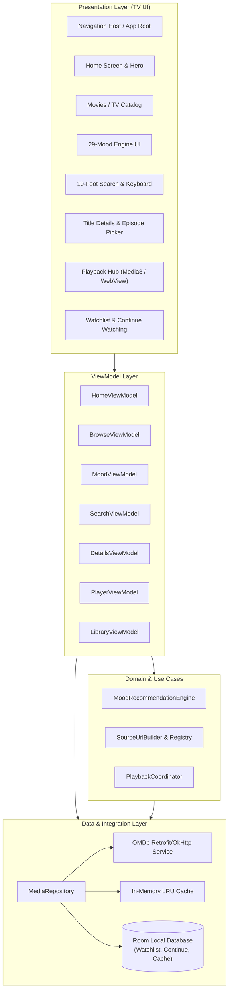

# Architecture Specification: NowShowing TV

## 1. System Overview & Clean Architecture

NowShowing TV is structured using Clean Architecture and the MVVM (Model-View-ViewModel) pattern, tailored specifically for Android TV's single-activity remote-navigation lifecycle.



## 2. Layer Responsibilities

### 2.1. Presentation Layer
- **TV Leanback & Compose UI**: High-contrast, large-format UI components styled for 10-foot viewing.
- **Focus Engine**: Focusable components maintain highlighted glow/elevation states and explicitly coordinate D-pad transitions.
- **ViewModels**: Expose reactive `StateFlow<UiState>` streams to screens. Handle asynchronous loading, error states, and pagination without blocking the main thread.

### 2.2. Domain Layer
- **MoodRecommendationEngine**:
  - Implements the exact 29-mood mapping from the web application.
  - Generates candidate query sets, deduplicates, invokes batch detail enrichment, computes genre intersection score (`_matchScore`), and orders results by `matchScore DESC, rating DESC`.
- **SourceUrlBuilder & SourceRegistry**:
  - Encapsulates URL formatting logic for all 11 video sources (`vidsrc.to`, `vidsrc.icu`, `vidsrc.me`, `autoembed.co`, `2embed.cc`, `2embed.stream`, `vidsrc.xyz`, `moviesapi.club`, `multiembed.mov`, `embed.su`, `vidsrc.mov`).
  - Constructs appropriate movie and series paths (injecting `season` and `episode`).
- **PlaybackCoordinator**:
  - Manages playback source selection, fallback rotation upon error, and hands off streams to either the native Media3 engine or the TV WebView engine.

### 2.3. Data Layer
- **OMDb Client (`OmdbApiService`)**:
  - Configured with OkHttp connection pooling, exponential backoff retries, and request deduplication.
  - Endpoints: Search (`s=`, `page=`, `type=`), Details (`i=`, `plot=full`), Season (`i=`, `Season=`), Title lookup (`t=`).
- **Two-Tier Caching System**:
  - **L1 In-Memory Cache**: 10-minute TTL for fast navigation between tabs.
  - **L2 Persistent Room Cache**: LRU-evicted SQLite table caching OMDb title summaries and mood genre mappings to minimize API quota consumption.
- **Room Database Entities**:
  - `WatchlistItemEntity`: Stores IMDb ID, Title, Poster, Year, Type, DateAdded.
  - `ContinueWatchingEntity`: Stores IMDb ID, Title, Poster, Year, Type, Season, Episode, LastPositionMs, DurationMs, UpdatedAt.
  - `MetadataCacheEntity`: Stores request key, JSON payload, and expiration timestamp.
  - `SearchHistoryEntity`: Stores query string and search timestamp.

### 2.4. Playback Architecture

```mermaid
flowchart LR
    SourceSelect["Source Selected"] --> CheckType{"Source Type & URL"}
    CheckType -->|Direct Stream (HLS/DASH/MP4)| Media3["AndroidX Media3\n(ExoPlayer)"]
    CheckType -->|Web Embed Provider| TVWebView["TV WebView Player\n(Hardware Accelerated)"]
    CheckType -->|External Player Option| ExternalIntent["Android Intent\n(VLC / JustPlayer)"]
    
    Media3 --> Progress["Track Real Time & Progress (Room)"]
    TVWebView --> Fallback["On Failure: Prompt Switch Source"]
    Media3 --> Fallback
```

1. **Native Media3**:
   - Primary player for direct media streams.
   - Provides native TV playback controls: timeline scrubber, Play/Pause, 10s skip, audio/subtitle selection, and error recovery.
   - Emits playback milestones to update `ContinueWatchingEntity`. Marks completion at 90% duration.
2. **TV-Optimized WebView**:
   - Custom `WebViewClient` and `WebChromeClient` with hardware acceleration enabled.
   - Injects custom viewport and styling to suppress desktop chrome and optimize for 16:9 full-screen presentation.
   - Captures back key to return cleanly to detail screen.
   - Monitors page load errors to trigger source rotation prompt.
3. **External Intent**:
   - Fires standard `ACTION_VIEW` intent with MIME type `video/*` allowing users to stream via VLC, Kodi, or external TV video players if preferred.

## 3. Directory Layout in Repository
The Android TV project is self-contained in `android-tv/`:
```
android-tv/
├── build.gradle.kts
├── settings.gradle.kts
├── gradle/
│   └── wrapper/
├── app/
│   ├── build.gradle.kts
│   ├── proguard-rules.pro
│   └── src/
│       ├── main/
│       │   ├── AndroidManifest.xml
│       │   ├── java/com/nowshowing/tv/
│       │   │   ├── NowShowingApp.kt
│       │   │   ├── data/
│       │   │   │   ├── api/
│       │   │   │   ├── db/
│       │   │   │   ├── model/
│       │   │   │   └── repository/
│       │   │   ├── domain/
│       │   │   │   ├── model/
│       │   │   │   ├── mood/
│       │   │   │   └── source/
│       │   │   ├── playback/
│       │   │   │   ├── Media3PlayerEngine.kt
│       │   │   │   ├── TvWebViewPlayerEngine.kt
│       │   │   │   └── PlaybackCoordinator.kt
│       │   │   └── ui/
│       │   │       ├── common/
│       │   │       ├── home/
│       │   │       ├── browse/
│       │   │       ├── mood/
│       │   │       ├── search/
│       │   │       ├── details/
│       │   │       ├── player/
│       │   │       ├── library/
│       │   │       └── theme/
│       │   └── res/
│       │       ├── drawable/
│       │       ├── layout/
│       │       ├── values/
│       │       └── xml/
│       └── test/
```
